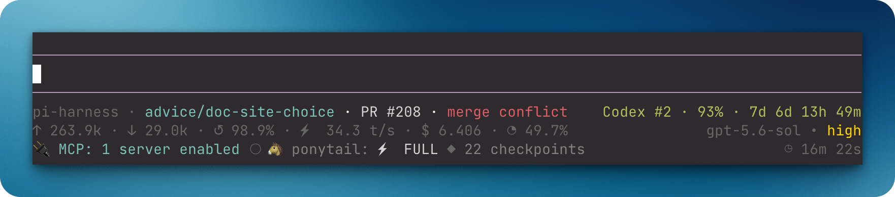

# pi-footer（C-git-qok fork）

> 本 fork 基于 [@HenryQW/pi-harness](https://github.com/HenryQW/pi-harness) 仓内 pi-footer（v2.2.4），显示层修改：第一行 checkout 标识后追加 session name（与 Pi 内置 footer 一致）；用量行移除费用（$）显示，紧缩为单空格分隔，顺序改为「缓存命中率、TPS、上下文占用」在前、「输入、输出」在后，缓存命中率图标 `↺` 改为 `»`，TPS 图标 `⚡` 改为 `↯` 且数值与单位去空格，上下文图标 `◔` 改为 `🧠`；其余与上游一致。

Keep checkout identity, model usage, elapsed agent work, and extension status visible while you work in Pi. See repository, pull request, model, and status details without separate commands.



## Install

```bash
pi install git:github.com/C-git-qok/pi-footer
```

## Works with

| Package | Relationship | Purpose |
| --- | --- | --- |
| [`@henryqw/pi-codegraph`](https://pi.henry.wang/extensions/pi-codegraph) | Improves | Shows CodeGraph index status, quiet setup progress, and direct tool activity when loaded. |
| [`@henryqw/pi-multi-codex`](https://pi.henry.wang/extensions/pi-multi-codex) | Improves | Adds active Codex subscription quota and reset status. |
| [`@henryqw/pi-open-in`](https://pi.henry.wang/extensions/pi-open-in) | Improves | Adds `/open` and `/set-open-in` commands for editor configuration. |
| [`@henryqw/pi-pr`](https://pi.henry.wang/extensions/pi-pr) | Improves | Adds current-branch pull-request status. |

## Use

After installing, start a Pi TUI session to see checkout, usage, model, thinking, and extension statuses.

```text
pi-harness · clear-field-f8d2 [+2 ~3 ?1 ↑2] · PR #123 · approved • 修 footer 图标    Codex #1 · 50% · 7d 1d 1h 22m
»84.3% ↯87.4t/s 🧠73.6k/200.0k[36.8%] ↑12.4k ↓2.1k    gpt-5.6-luna • high
✓ CG · ●  🐴 ponytail: ⚡ FULL                                          ◷ 12m 34s
```

- The first line shows the repository, branch, Git state, and `pi-pr` pull request status beside the checkout identity, followed by the session name when the session has one. The `pi-multi-codex` quota status, when non-empty, occupies the right side. Linked-worktree branches drop the generated `worktree/` prefix.
- The second line shows the latest cache-hit rate, tokens per second for the most recent assistant response, and context usage as used/window and percent inside brackets, then cumulative input and output tokens, separated by single spaces. The rate is timed from the response's first streamed content to its last, so request latency, time to first token, and provider work after the stream ends (such as Claude bridge shutting down Claude Code) are excluded. A response streamed for less than 250 ms, delivered without streamed content, or arriving all at once shows `—`. Totals include reported tool usage and finished `pi-subagent` background workflows. The active model and thinking level are right-aligned. Under a virtual model, the physical model and thinking level of the latest successful response follow an arrow, for example `auto • high → gpt-5.6-luna • medium`, matching Pi's built-in footer.
- The third line shows CodeGraph's icon and `CG` first: `✓ CG` when indexed, `○ CG` when a Git repository has no index, or a dim spinner and elapsed time such as `⠋ CG · indexing 8s` during setup. Non-Git directories show no index badge. Other extension statuses follow, such as `⠋ deps · installing 12s`; dependency preparation statuses disappear when work completes. Persistent CodeGraph failures retain their theme-colored `!` icon and meaningful text. During direct `codegraph_explore` calls, `● CG` temporarily replaces the CodeGraph status, which returns when the call finishes. A middle dot separates statuses; cumulative agent-work time stays on the right, beneath the active model.

Git badges appear only when action is needed:

| Badge | Meaning |
| --- | --- |
| `+2` | Two staged paths |
| `~3` | Three unstaged tracked paths |
| `?N` | `N` untracked porcelain status entries |
| `!1` | One unresolved path |
| `↑2` | Two commits ahead of the upstream branch |
| `↓1` | One commit behind the upstream branch |

`?N` counts porcelain status entries. In `--untracked-files=normal` mode, Git may collapse a whole untracked directory to one entry.

Active operations appear first, such as `REBASE 3/7`, `MERGING`, or `CHERRY-PICKING`. Detached HEAD uses the short commit form `@a1b2c3d`.

The extension reads local Git data with `git status --porcelain=v2 --branch --untracked-files=normal`. It refreshes after each agent run and branch change. It does not make an LLM call or fetch a remote. Ahead and behind counts use the last fetched upstream state.

Unavailable values render as `—` without a misleading percent sign.

`off` uses the same dim grey as the model name. Active levels use an ANSI-256 gradient: green `minimal`, yellow-green `low`, lime `medium`, yellow `high`, orange `xhigh`, and red `max`.

`ultra` renders as a rainbow when the active Pi runtime supplies that thinking level. Unsupported levels never appear.

Only the non-empty `pi-multi-codex` quota status occupies the right side of the first line. The `pi-pr` pull-request status stays beside checkout identity, and CodeGraph index status, setup progress, or tool activity appears separately on the third line.

Statuses from other extensions, including Ponytail and `pi-rewind`, share the left side of the third line. They are sorted by key; colors, links, glyphs, and interior spacing are preserved. Leading and trailing whitespace is trimmed, line breaks become spaces, and long statuses may be clipped to fit the footer. Only direct `codegraph_explore` tool calls trigger the `● CG` badge; CodeGraph queries made from inside scripted tools are not shown.

## Limits and recovery

When the configured executable is `code` and Pi reports hyperlink support, the accent-colored checkout name links to the current path. The link opens a new window for `code -n` or `code --new-window`. A missing config silently uses `code`. Other executables and terminals with hyperlinks disabled render plain text.

Pi handles the custom URI in its fullscreen TUI, which is the default since Pi 1.0. Then use normal primary click. On older supported Pi versions (before 1.0), enable it:

```json
{
  "tuiMode": "fullscreen"
}
```

Set this through `/settings`, or launch with `--tui-mode fullscreen`. Regular TUI (`"tuiMode": "regular"` or `--tui-mode regular`) delegates OSC 8 activation to the terminal, so the link works only where the terminal opens custom URI schemes.

Ghostty uses `Cmd+click` but may not open custom URI schemes.
